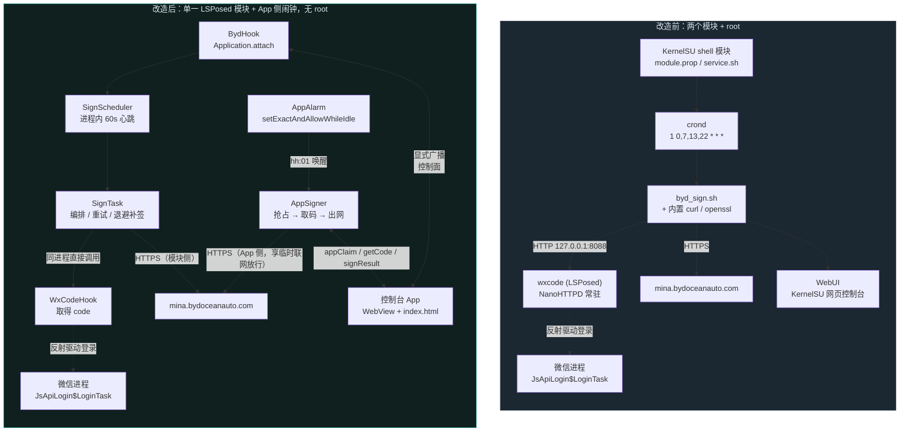

# BYD 自动签到 · LSPosed 模块

[](https://github.com/linbailo/byd-lsp/actions/workflows/build-apk.yml)
[](LICENSE)

一个 **LSPosed 模块 + 自带控制台 App**：在微信进程内拿到小程序的登录 `code`，
直接调用比亚迪小程序接口完成每日签到。**不需要 root**，不需要 crond / curl / openssl，
也不占用任何本地端口。

它把这两个项目合并成了一个：

- [xiaojinwen/byd_sign](https://github.com/xiaojinwen/byd_sign) —— KernelSU/Magisk shell 模块，靠 crond + curl + openssl 定时签到
- [xiaojinwen/wxcode](https://github.com/xiaojinwen/wxcode) —— LSPosed 模块，Hook 微信小程序登录并暴露 `127.0.0.1:8088` 取 code

**改动要点**：取消 wxcode 的本地 HTTP 链路，`code` 在微信进程内取到后**直接交给签到引擎**；
定时、重试、通知都搬进模块进程，`byd_sign` 的 shell/crond/curl/openssl 整条依赖链被删除。

## 快速开始

```text
1. 装 APK  → 2. LSPosed 勾选模块、作用域选微信 → 3. 强行停止微信再打开 → 4. 打开 App 点「立即签到」
```

APK 就在仓库根目录：`byd-lsp-1.22.0-release.apk`；
也可以从 [Releases](https://github.com/linbailo/byd-lsp/releases) 下载（打 `v*` 标签时自动发布并附带已签名的 APK），
或从 Actions 的 `byd-lsp-apk` 产物里拿最新的。

- **要求**：Android 8.0+（minSdk 26）、已装 LSPosed（或 EdXposed 等兼容框架）、微信里能看到比亚迪小程序。
- **工具链**：要自己构建的话，JDK 17 + Android SDK（platform 34 / build-tools 34）即可，
  `build-apk.ps1` / `build-apk.sh` 会自动接管；推到 GitHub 后 Actions 也会直接产出 APK（见[构建](#三构建-apk)）。
- **注意**：正式包用的是仓库自带的自签密钥，与旧 debug 包**签名不同**，装过旧 debug 包要先卸载。

## 目录

| 章节 | 内容 |
|---|---|
| [一、架构对比](#一架构对比) | 改造前后对比、为什么不需要 root |
| [二、目录结构](#二目录结构) | 源码与自检脚本分布 |
| [三、构建 APK](#三构建-apk) | 本地构建、CI 构建、工具链 |
| [四、安装与启用](#四安装与启用) | 四步装好并验证 |
| [五、核心接口](#五核心接口沿用原项目未做任何改动) | 比亚迪接口协议、微信版本适配表、dex 探测策略 |
| [六、控制台 App](#六控制台-appindexhtml) | 各页面功能、配置在哪、触发链路（三层） |
| [七、已知限制](#七已知限制) | 边界与前提 |
| [八、自检](#八自检) | 7 个自检脚本与产物核验 |
| [九、版本历史](#九版本历史) | 指向 [CHANGELOG.md](CHANGELOG.md) |
| [十、不生效排查](#十lsposed-勾选后不生效的排查) | LSPosed 勾了却没反应怎么查 |
| [十一、注入状态怎么判断](#十一模块注入状态是怎么判断的) | 握手机制 |
| [十二、免责声明与致谢](#十二免责声明与致谢) | |

---

## 一、架构对比



对照表：

| 环节 | 改造前 | 改造后 |
|---|---|---|
| 取 code | wxcode 起 NanoHTTPD，外部 curl 打 `127.0.0.1:8088` | 微信进程内反射调用，直接拿到字符串 |
| 端口分配 | `8088 + userId`，还要向主端口注册实例 | 不存在了 |
| 定时 | KernelSU crond + `service.sh` | `SignScheduler` 进程内心跳 + 启动补签；再叠一层 **App 侧精确闹钟** |
| HTTP | 模块内置静态 curl 二进制（每 ABI 6~7MB） | `HttpURLConnection`；1.18.0 起优先**由 App 进程发出**（拿闹钟的临时联网放行） |
| 加解密 | 模块内置 openssl 二进制 | JCE `AES/CBC/PKCS5Padding` + `MessageDigest` |
| 唤醒微信 | `am startservice .booter.CoreService` + Doze 白名单 | 不需要（同进程）；现在改成「闹钟唤醒 App + App 出网」 |
| 失败处理 | 一次失败就等下一个定时点 | 退避表补签（1/3/10/30/60 分钟，窗口 1 小时）+ 打开 App 顺手补签 |
| 通知 | shell 拼 SMTP / JSON | `SSLSocket` 直连 SMTP + 复用 HTTP 客户端；成功/失败可分别开关 |
| 控制台 | KernelSU WebUI 读 `/data/adb/byd_sign/` | App 内 WebView + 广播通道 |
| root | 必需 | **不需要** |

---

## 二、目录结构

```
.
├── index.html                       ← 控制台 App（单文件，也是模块 WebUI 的源文件）
├── build-apk.ps1 / build-apk.sh     ← 本地一键构建
├── .github/workflows/build-apk.yml  ← 推到 GitHub 自动出 APK（无需本地环境）
├── CHANGELOG.md                     ← 逐版改动与原因
├── LICENSE                          ← MIT
├── .gitattributes                   ← 换行符规则（.sh 必须 LF、xposed_init 字节数敏感）
├── reverted/                        ← 已回退功能的实现存档（不参与构建，见其 README）
├── tests/                           ← 纯 Node 的自检脚本，不依赖任何框架
│   ├── verify-crypto.mjs            ← 用 NIST 标准向量校验 AES-128-CBC 与 SHA-256
│   ├── verify-app.mjs               ← DOM 桩跑 init() 与配置页逻辑，查运行期异常
│   ├── check-html.mjs               ← index.html 标签配对 / id 唯一性 / 引用完整性
│   ├── check-version-table.mjs      ← 内置版本表逐版本断言（锁死 static/instance 方法名）
│   ├── check-java.mjs               ← Java 源码括号配对
│   ├── check-refs.mjs               ← Java 源码跨文件成员引用
│   └── check-docs.mjs               ← 文档自检（目录锚点 / 相对链接 / 本机路径泄漏）
└── byd-lsp/                         ← LSPosed 模块（Gradle 工程）
    ├── settings.gradle / build.gradle / gradle.properties
    ├── keystore.properties          ← release 签名口令（自签一次性密钥）
    ├── byd-lsp-release.jks          ← release 签名密钥
    └── app/
        ├── build.gradle             ← 构建时把 ../index.html 复制成 assets/webui/index.html
        └── src/main/
            ├── AndroidManifest.xml  ← xposedmodule / xposedscope=com.tencent.mm
            ├── assets/xposed_init   ← 入口类，23 B 且末尾无换行（多一个换行会让模块加载失败）
            ├── assets/wxcode_versions.json  ← 内置微信版本适配表（10 个版本，构建时编译成常量）
            └── java/xiaojw/byd/
                ├── hook/  BydHook · WxCodeHook · WxVersionTable · DexProbe
                │          JsApiLoginAnalyzer · HookReceiver
                ├── sign/  BydProto · BydCrypto · BydHttp · BydSignEngine
                ├── core/  SignTask · SignScheduler · Notifier · HookStore
                │          BydConfig · LogStore · ModuleState · Ipc · NetProbe
                └── ui/    MainActivity · WebBridge · StateReceiver · AppStore
                           AppAlarm · AppSigner · AppSignReceiver
```

`hook` / `sign` / `core` 跑在**微信进程**里（LSPosed 注入的模块），
`ui` 跑在**控制台 App 进程**里 —— 第三层的闹钟与出网就在这一侧。

---

## 三、构建 APK

仓库根目录已经放了构建好的正式版：

```
byd-lsp-1.22.0-release.apk    120 KB   （已签名、无 debuggable、单 dex）
```

### 需要什么

| 组件 | 版本 | 说明 |
|---|---|---|
| JDK | 17 | AGP 8.5 要求 |
| Android SDK | platform 34 + build-tools 34.0.0 | 只用到编译期 |
| Gradle | 8.9，或用 Android Studio 自带 | 也可以直接用 Android Studio 打开 `byd-lsp/` |
| Xposed API 存根 | `api-82.jar`（约 25 KB） | 首次构建时脚本会自动从 `api.xposed.info` 下载到 `byd-lsp/app/libs/`。**国内网络取不到时**，手动放一份进去即可（文件名必须叫 `api-82.jar`） |

### 本地构建

```powershell
# Windows
powershell -ExecutionPolicy Bypass -File .\build-apk.ps1

# 指定别的工具链位置（相对或绝对路径都行）
powershell -ExecutionPolicy Bypass -File .\build-apk.ps1 -Toolchain ..\android-toolchain
```

```bash
# macOS / Linux
BYD_TOOLCHAIN=/opt/byd-toolchain ./build-apk.sh
```

脚本会检查工具链、补下 Xposed API 存根、构建，并把 APK 复制到仓库根目录。
**默认构建 release**（原因见下），并在产物上做强制校验。

### 不想配本地环境：交给 GitHub Actions

把仓库推上去之后，`.github/workflows/build-apk.yml` 会在 push 到 `main`/`master`、
**打 `v*` 标签**、或手动触发时构建；到 Actions 页面下载 `byd-lsp-apk` 产物即可。
它同样会校验「单 dex + 资源齐全 + 签名」，不达标直接失败。

### 发布新版本（打标签 = 自动出 Release）

改完 `byd-lsp/app/build.gradle` 里的 `versionCode` / `versionName`，推一个同名标签：

```bash
git tag v1.20.7          # 改成你要发布的版本号
git push origin v1.20.7
```

Actions 会构建并校验，然后**自动创建 Release、把已签名的 APK 作为附件附上**
（Release 说明由 `--generate-notes` 从这之间的提交记录生成）。
有两条前置检查，不满足就直接失败，避免发出对不上的包：

- **标签必须与 `versionName` 一致**：`v1.20.7` ↔ `versionName '1.20.7'`；
- 构建产物仍然要过「单 dex + 资源齐全 + 签名」那套校验。

已经存在的同名 Release 不会报错，会改为**覆盖上传**附件。
不装 git 也可以让别人用 API 打标签，规则同上。

### 发布到 LSPosed 官方模块库（「在线模块」列表）

LSPosed Manager 里的「在线模块」列表来自官方组织
[Xposed-Modules-Repo](https://github.com/Xposed-Modules-Repo)：
每个模块在其中有一个以**包名**命名的仓库，列表由它的构建任务生成。

**第一个门槛是包名**，官方要求二选一：

- `io.github.{你的 GitHub 用户名}.*` —— 免域名、免验证，最省事；
- 或者你自己**拥有**的域名的反写，并在根域加一条 TXT 记录
  `lsposed-modules-repo-verification={你的 GitHub 用户名}`。

> 本项目 1.22.0 起用 `io.github.linbailo.byd` 正是为了满足这一条
> （之前是 `xiaojw.byd`，虽然是反域名写法但不属于自己拥有的域名）。
> Java 包名仍保留 `xiaojw.byd.*` —— `applicationId` 和 Java 包名是两回事。

**流程**（提交入口是网页表单，会带你到 GitHub 开 issue）：

1. 打开 [modules.lsposed.org/submission](https://modules.lsposed.org/submission)，
   选 `Submit a new package`，填 **Package name**（= APK 的 applicationId）和说明，
   点 `Submit on GitHub` —— 它会用模板在 `Xposed-Modules-Repo/submission` 开一个
   标题形如 `[submission] io.github.linbailo.byd` 的 issue；
2. 机器人会创建 `Xposed-Modules-Repo/io.github.linbailo.byd` 并把提交者加为 maintainer；
3. 在那个仓库里补 **`SUMMARY`**（首页一句话摘要）和 **`README.md`**（完整说明，
   **不要把源码放进去**），然后发 Release：
   标题 = `versionName`，内容 = 更新日志，
   **标签格式是 `[versionCode]-[versionName]`**（例如 `28-1.22.0`），
   **必须附上已签名的 APK** —— 只有带 APK 的 Release 才会被收录/更新；
4. 等 5~60 分钟，列表重建完成后，LSPosed Manager 里就能搜到，并会提示更新。

> 注意：**我们仓库自己的 Release 用的是 `v1.22.0`**（人看的）；
> 官方列表那个仓库里的标签要按 `28-1.22.0` 写。两边互不影响。

### 为什么必须 release（而不是 debug）

Xposed 模块**必须单 dex**。AGP 在 debug 变体下会把工程类按包拆成多个 dex
（`classes.dex` / `classes2.dex` / …，这是它内部的增量构建优化），
而 LSPosed 加载模块时通常只读 `classes.dex` —— 于是入口类
`xiaojw.byd.hook.BydHook` 根本找不到，表现就是**「LSPosed 里勾选了但没注入」**。
release 变体会合并成单个 `classes.dex`，脚本与 CI 对这一点都有强制校验，多 dex 直接报错退出。
顺带一提：`multiDexEnabled true`、`-Variant debug` 都解决不了这个问题，必须走 release。

### 关于签名

`byd-lsp/keystore.properties` 与 `byd-lsp/byd-lsp-release.jks` 是随仓库提交的**自签一次性密钥**
（口令也写在文件里）—— 作用只是让每个人构建出来的 APK 签名一致、能互相覆盖安装。
它**没有安全价值**，对外分发请换成你自己的密钥。
签名一致的正式版之间可以直接覆盖安装，不用先卸载（指纹 `73342536…5ba9716`）。

> 中文网络下如果卡在依赖下载：`maven.google.com` / `services.gradle.org` 都会超时。
> 开发机上用了一个 Gradle init 脚本把仓库换成阿里云镜像（`google` / `gradle-plugin` / `public`）；
> 换到能直连的网络时去掉它即可。

---

## 四、安装与启用

0. **装过旧版先卸载。** 旧 debug 包的签名（`CN=Android Debug`）与正式版不同，
   不卸载会报 `INSTALL_FAILED_UPDATE_INCOMPATIBLE`。1.1.0 之后的正式版签名一致，可直接覆盖 ——
   **但 1.22.0 换了包名**（`xiaojw.byd` → `io.github.linbailo.byd`，为了满足 LSPosed 官方模块库的
   命名要求）。包名变了就是另一个应用，所以这一版**必须先卸载旧版再装**，
   装好后到 LSPosed 里重新勾选新包名的作用域。
   模块的签到状态存在**微信自己的** SharedPreferences 里，**不会丢**；
   控制台 App 的配置要重配一次（旧的
   `/sdcard/Android/data/xiaojw.byd/files/config.json` 可以复制到新目录
   `/sdcard/Android/data/io.github.linbailo.byd/files/config.json`）。
1. 安装 `byd-lsp-1.22.0-release.apk`。
2. LSPosed 管理器 → 模块 → 勾选 **BYD 自动签到**。
3. 作用域勾选 **微信**（`com.tencent.mm`）。系统分身/多开包名相同，勾一项即可覆盖所有实例。
4. 强行停止微信后重新打开。LSPosed 日志里应出现：
   ```
   [byd-lsp] INFO 模块已注入 主应用（微信 8.0.78，User 0）
   [byd-lsp] INFO 取码方式：进程内直接调用，无本地端口转发
   [byd-lsp] INFO 定时器已启动：每天 00:01 / 07:01 / 13:01 / 22:01（进程内心跳，含启动补签与失败补签）
   ```
5. 打开 **BYD 自动签到** App，在「设置」里确认品牌与 AppID，回「首页」点 **立即签到** 验证。
6. 到「设置」页看一眼「**App 定时唤醒**」卡片：这里会显示下一次唤醒时间与精确闹钟授权状态。
   Android 14+ 建议点一次「去允许『闹钟和提醒』」—— 授权后定时点才准点，
   不授权也能跑，只是可能晚十几分钟。

App 顶栏显示「已注入」= 收到了微信进程内模块的握手应答；「未响应」= 暂时没接上话
（页面会每 30 秒自动重试）；「演示模式」= 页面没跑在 APK 里。

---

## 五、核心接口（沿用原项目，未做任何改动）

两步 HTTPS，请求体是 AES-128-CBC(PKCS#7) 后的 Base64，响应同样是 Base64 密文：

```
① POST https://mina.bydoceanauto.com/?service=mina.decryptCode
   body   : {"code":"<wx.login 返回的 code>"}
   → 解出 session_id

② POST https://mina.bydoceanauto.com/?s=ForCommonUcSrv.forward&serviceDir=activity/sign/signIn
   body   : {"date":"","belong_brand":"hy","session_id":"...","app_version":"460","app_client":"mina"}
   → ret == 200 即签到成功，durationDays 为连续天数
```

签名头（每次请求重新生成）：

| 头 | 说明 |
|---|---|
| `Nonce` | 16 位随机串，字符集与原实现一致 |
| `Curtime` | 秒级时间戳 |
| `Checksum` | `SHA256(APPSECRET + Nonce + Curtime)` |
| `X-Clienttraceid` | `mina-8-4-4-4-12` 形式（非标准 UUID，逐位复刻原实现） |
| `Appkey` / `Referer` | `hyMinaApi` / `https://servicewechat.com/<AppID>/142/page-frame.html` |
| `Accept-Encoding` | 固定 `identity`，防止响应被压缩后当成密文解密 |

密钥与 AppID 与 `byd_sign.sh` 完全一致（AppID 同样分段持有、运行时拼接）。

### 微信版本适配表

Hook 依赖混淆后的类名，随微信版本漂移。适配数据不再硬编码在 Java 里，而是：

1. **内置资源** `assets/wxcode_versions.json` —— 收录 **10 个版本**，全部取自
   [xiaojinwen/wxcode-hook-config](https://github.com/xiaojinwen/wxcode-hook-config)：

   | 版本 | 来源 | 备注 |
   |---|---|---|
   | 8.0.49 | `KNOWN_EDITION_CONFIGS.domestic` | `j1_instance_method=f` |
   | 8.0.62 / 8.0.70 / 8.0.71 / 8.0.72 / 8.0.74 | `known_configs.json` | |
   | **8.0.68** | `KNOWN_EDITION_CONFIGS.play` | **Play 版**，回调在 `plugin.type.jsapi.auth` |
   | 8.0.76 | `hook_config_8.0.76.json` | 回调位移到 `i2` / `m2` |
   | 8.0.77 / 8.0.78 | `hook_config_domestic_*.json` | `j1_static_method=e` |

   > **发行版差异**：国内版的回调类在 `plugin.appbrand.jsapi.auth`，Google Play 版在
   > `plugin.type.jsapi.auth`，两者不可混用。模块启动时会**运行时探测**当前是哪一版
   > （尝试加载两个包下的 `JsApiLogin$LoginTask`），配置里的回调包与发行版不符时
   > 会判定为未精确命中并自动重新探测。`DexProbe` 也只会在匹配的包里找 a1/a7。
2. **配置覆盖层** —— 配置文件里的 `versionTable` 字段，可由控制台编辑，也由运行时探测自动追加
3. **运行时 dex 探测** —— 由控制台按钮手动触发，或打开「自动解析 dex 生成配置」开关后自动执行

#### 内置表为什么是编译进代码的常量

模块跑在**微信进程**里，那里 `context.getAssets()` 指向的是**宿主（微信）的 APK**：
`am.open("wxcode_versions.json")` 找的是微信包里的资源，必然 `FileNotFoundException`。
于是 `readAsset()` 返回 `"{}"`，**内置版本表一直是空的**，表内容只能来自控制台的覆盖层。

这个错误很隐蔽，因为：控制台 App 读的是**自己**的 assets（一切正常，配置页能列出 10 个版本）；
模块侧只要覆盖层非空就看不出异常 —— 而覆盖层一旦被清空，`j1/c/a1/a7` 全空，
取码直接报「没有可用的 Hook 配置」。

现在的做法：`assets/wxcode_versions.json` 仍是**唯一来源**（也是控制台展示用的那份），
构建时由 `generateVersionTableDefault` 任务把它转义成 `WxVersionTableDefault.JSON`，
模块侧直接读常量，完全不碰资源系统。改版本表仍然只改那个 JSON。

> **默认自动解析，但每个版本只探一次。** `autoProbe` 默认为 `true`：版本表已收录的版本直接用它
> （根本不会去动 dex）；只有未收录的版本才分析 dex，**而且结果无论成败都会记账** ——
> 同一个微信版本不会重复扫第二遍（手动/ adb 触发是强制重跑）。
> 关闭这个开关则完全按版本表走、未收录时就近匹配；关掉时 App 会把之前探测生成的覆盖项一并清空。

三者按「内置 → 覆盖层 → 探测结果」叠加，`WxVersionTable` 负责解析，所以更新字典不需要重新编译 APK。

#### dex 探测怎么工作

**首选：按 wxcode-hook-config 的判定依据，反汇编 `JsApiLogin$LoginTask` 自己的调用点。**

那个项目是「反编译 `JsApiLogin$LoginTask`，在**它的代码里**找四个调用点」：

| 字段 | 源码形态 | 在 dex 里的判据 |
|---|---|---|
| `a1` | `new b2(this)` | `<init>(LJsApiLogin$LoginTask;)V` 的调用，实参是本类 |
| `a7` | `new f2(this, b2Var)` | `<init>(LJsApiLogin$LoginTask;L<A1>;)V`，第二参用 a1 交叉验证 |
| `c` | `new o60.c(...)` | `<init>(Ljava/lang/String;Ljava/util/LinkedList;…)V`，末参是 a7 |
| `j1` | `u70.k1.d().f(cVar)` | 接收 `c` 的实例方法，其接收者类型等于某个无参静态方法的返回类型 |

`JsApiLoginAnalyzer` 直接解析该类的 `class_data` / `code_item`：按 dex 指令长度表跳过无关指令，
只挑出 `invoke-direct` / `invoke-static` / `invoke-virtual` 的 method 索引，再查 proto 表拿参数与返回值。
只解析**一个类**，不做整包反编译；逐个 dex 流式扫描，一次只驻留一个 dex。

这比「按形状在全体类里搜」可靠 —— 后者可能命中形状相同、但不是登录链的类，
表现为**自检全绿、取码却毫无反应**。自检里也加了「JsApiLogin 调用点对照」这一步，
把 dex 里算出来的四个类与当前配置并排比对，不一致会直接标红。

**兜底：形状搜索。** 调用点分析失败（例如 dex 读不到），或分析出的类加载不出来时，
才退回下面这套按签名匹配的做法，并把退回原因写进探测过程：

| 字段 | 源码形态 | 运行时判据 |
|---|---|---|
| `a1` | `Cls v = new Cls(this)` | 单参构造，参数可接收 `LoginTask` |
| `a7` | `Cls v = new Cls(this, cb)` | 双参构造 `(LoginTask, a1)` |
| `c`  | `new pkg.cls(str, LinkedList…)` | 参数 6~10 个、首参 String、次参可接受 LinkedList、末参可接收 `a7`，8 参优先 |
| `j1` | `pkg.cls.d().g(cObj)` | 静态无参方法返回的实例上，再有一个只接收 `c` 的方法 |

类名来源同时覆盖安装包 dex 与**运行时实际加载的 dex**（反射 `BaseDexClassLoader.pathList`）——
微信用 Tinker 热修后，磁盘上的包与内存里的代码可能不一致。

探测期间每个候选类的反射都单独 try/catch：微信里大量类互相依赖，
一个抛 `NoClassDefFoundError` 的类不应该中断整轮探测。

#### 取码还依赖一批「版本表里没有」的字段名

取码除了 `j1/c/a1/a7` 四个类名，还要往 `LoginTask` 里写一批字段、再从里面读结果。
**这批字段名同样会随微信版本漂移，而 `xiaojinwen/wxcode-hook-config` 并不提取它们** ——
那个项目只产出那四个类名。所以「版本表明明命中、取码还是失败」最常见的原因就在这里。

| 角色 | 默认字段 | 用途 |
|---|---|---|
| `action` | `o` | 写入 `"login"` |
| `appId` | `p` | 写入小程序 AppID |
| `s` | `s` | 写入 `1` |
| `v` | `v` | 写入 `""` |
| `t` / `u` | `t` / `u` | 写入 `0` |
| `A` | `A` | 写入 `1271` |
| `state` | `r` | **读**：非 `null` 表示登录流程结束 |
| `code` | `q` | **读**：真正的 code —— 原实现里最容易读错的一处 |

默认值取自原 wxcode 模块（8.0.49 ~ 8.0.76 实测可用）。字段名漂移时**不需要重新编译**，
在「配置」页的 `versionTable[版本].loginTask` 里按角色覆盖即可：

```json
"8.0.90": {
  "j1": "...", "c": "...", "a1": "...", "a7": "...",
  "loginTask": { "state": "r2", "code": "q2" }
}
```

字段名对不上时，模块抛出的错误里会带上本机真实字段名与序号：

```
LoginTask 字段名不匹配：角色 state 映射到 "r"，本机实际字段 [#0 o:String, #1 p:String, #2 s:int, ...]
可在「配置」页的 versionTable[8.0.90].loginTask 里改成正确名字
```

#### 取码自检

「签到没反应」时先跑 **配置页 → 取码链路自检**。它按 `getCode` 的每一步单独走一遍
（**不触发真实登录、也不等待 code**），逐步报告结果，并把反射看到的真实字段名与构造签名打出来：

```
版本配置                 ok   微信 8.0.90（国内版）| j1=… c=… a1=… a7=…
加载 j1                  ok   hm0.j1
LoginTask 字段逐个校验    ok   action="o":String appId="p":String … state="r":String code="q":String
a1 单参构造              ok   (LoginTask)
c 构造                   ok   (String, LinkedList, int, String, String, int, int, l2)
j1 调用链                err  本机实际是 .e().g(c)，但配置里写的是 .d().g(c) —— 需要改 j1_static_method
试构造 LoginTask/a1/a7/c  ok   全部成功（未触发登录）
```

失败步骤会标红并给出原因。同一结果也会写进日志页。

### 自动解析 dex 的策略（严格对齐 wxcode-hook-config）

未收录的微信版本由模块在本机 dex 里反查四个目标。判定规则**逐条对齐**参考项目
`xiaojinwen/wxcode-hook-config` 的 `scripts/extract_hook_config.py`（v3 策略），
只是把它的「jadx 反编译 + 正则」换成「读 dex 的 code_item + 调用点分析」：

| 目标 | 参考项目的规则 | 本机实现（对齐说明） |
|---|---|---|
| `a1` | `(\w+)\s+\w+\s*=\s*new\s+\1\s*\(\s*this\s*\)` → `new Cls(this)`；期望名 +10、包内存在同名文件 +5 | LoginTask 里 `<init>(LoginTask)` 的调用目标，且候选限定在 auth 回调包里 |
| `a7` | `(\w+)\s+\w+\s*=\s*new\s+\1\s*\(\s*this\s*,` → `new Cls(this, cb)` | LoginTask 里 `<init>(LoginTask, a1)` 的调用目标（用 a1 交叉验证） |
| `c` | `new\s+(\w+)\.(\w+)\s*\([^)]{10,}` **+ 打分**：参数 ≥6 → +10；==8 → +5；类文件存在 → +3 | LoginTask 里 ≥6 参 `<init>` 的调用目标 + 同一套打分（末参 a7 / 首参 String / 次参 LinkedList 都只是**加分项**） |
| `j1` | `(\w+)\.(\w+)\.([a-z])\(\)\s*\.\s*([a-z])\(` → 链式调用 `X.Y.e().g(c)`，**不检查 `g` 声明在哪个类上** | dex 里 `invoke-static` → `move-result-object v0` → `invoke-virtual {v0,…}` 寄存器对得上即命中；同类型优先、继承声明也收 |
| 登录类 | `$LoginTask.java` → `JsApiLogin.java` → 内容里找 `post initialized` | `$LoginTask`（本发行版 → 另一发行版）→ `JsApiLogin`（同序），四种候选一趟扫完 |
| 标记串 | `Call post initialized callbacks now` / `/cgi-bin/mmbiz-bin/js-login` | 在登录类所在的那个 dex 上顺手查一次，结果打进「探测过程」 |

三条要点（也是 1.20.x 修掉的三处偏差）：

1. **不要给 `c` 设类型/名字门槛**，只打分。参考项目对 `c` 只做候选打分，名字和参数类型都不是必要条件。
2. **不要给 `j1` 写死类名，也不要要求 `g` 声明在静态方法的返回类型上**。
   类名会随混淆漂移（8.0.76 `hm0.j1` → 8.0.79 `pp0.i1`）；参考项目匹配的是**调用形状**，
   继承/接口来的 `g` 同样算。
3. **`c` 以 j1 链上的参数类型为准**。源码里的 `g(c)` 已经说明了 c 是谁；
   靠形状先猜 c 再配 j1，一旦猜错就整轮失败。

有意保留的三处差异（都是为了 dex 层的现实条件）：

- `c` 的第三个加分项「类文件存在 +3」→ 换成「确实在 LoginTask 里被 new 出来 +3」与「名字像 c/d +3」
  （dex 里没有源码文件可查）。
- `a1/a7` 的「期望名 +10」→ 没做：那要靠版本表里的期望值来消歧，而本机探测的意义正是**不依赖版本表**；
  我们改用更强的判据（构造参数就是 LoginTask 类型）。
- 参考项目的 `DexFallbackSearcher` 用硬编码前缀表枚举 `j1`/`c`（`hm0/gm0/dl0…` × `j1/k1`，`cl0/bl0/…` × `c/d`）——
  那张表对 8.0.79 也是失效的。我们改成全量枚举 + 打分，只在**优先顺序**上保留「先试已知前缀」的思路。

探测结果写回配置时会做两件归一化：dex 内部名 `pp0/i1` → `pp0.i1`，
以及剥掉 `com.tencent.mm.` 前缀（Hook 侧拼类名时会自己补上）。

失败时日志里会打出 `c` 的候选清单（形如 `ko0.c(8 参/评分 18)、…`），
下次微信再改结构，看这一行就知道该往哪个方向扩展。

#### 尝试取码（真的跑一次）

自检通过、但取码还是失败时，点 **尝试取码**。它会**真的发起一次小程序登录**，
每 500ms 采样一次 `status` / `code`，最后列出：

- **最终 `status` 与 `code`** —— `status` 一直是 `null` 说明登录根本没跑起来
- **LoginTask 全部字段的实际值** —— 如果 code 落在别的字段上，这里能看出来
- **采样时间线** —— 能看出是「一直没反应」还是「20 秒后才返回」（后者说明只是慢）
- **调用过程** —— `j1.d()` 返回了什么、`.g(c)` 的返回值是不是 `false`（表示被拒绝入队）

取码等待上限默认 **30 秒**（与原 wxcode 的 `doLogin` 一致），可在
「设置 → 取码等待上限」调到 5~120 秒。

---

## 六、控制台 App（`index.html`）

单文件、零外部依赖、可离线跑。装进 APK 时通过 `window.BYDModule` 走真实通道；
直接用浏览器/模拟器打开时自动进入**演示模式**，但加密与请求构造仍是真实实现：

- **首页** —— 连续天数状态环、四个定时点进度、下次倒计时、立即签到/停止；
  引擎卡里第一行就是**模块注入状态**
- **实例** —— 顶部是 LSPosed 注入状态（状态 / 模块版本 / 微信进程 pid / 最近响应时间 +
  「重新检测」），下面才是主应用 / 分身的实例列表
- **日志** —— 增量日志、级别过滤、复制/清空；顶部一行**投递对账**
  （模块推了几批 / 本机收到几批），被系统拦后台唤醒时会给一个「允许本应用后台运行」入口
- **配置** —— 微信版本适配状态（绿/红）、一键重新探测本机微信、当前支持版本一览（一行 3 个版本号，含本机探测生成的那些）、生效版本表、**模块侧实际生效配置**（含**运行时开关的真实取值**），
  以及**整份配置文件的加载 / 查看 / 修改 / 保存**（含 `versionTable` 版本字典）
- **设置** —— 自动签到 / 当天成功后不再重复 / 取码前切微信、尝试次数与间隔、
  **App 定时唤醒**（下一次唤醒时间、精确闹钟授权与入口）、
  邮件与 Webhook（企业微信/钉钉/Telegram/PushPlus/自定义）以及**成功时通知 / 失败时通知**策略。
  品牌与小程序 AppID 固定为海洋网、只读；编辑框有变动即提示「保存成功」

### 配置文件在哪里、怎么工作

**只有一份配置，不会分裂成多个文件。** 保存时同时写三处，内容完全一致：

| 位置 | 内容 | 用途 |
|---|---|---|
| `/sdcard/Android/data/io.github.linbailo.byd/files/config.json` | **完整配置**：所有设置项 + 完整微信版本表 | 用文件管理器查看 / 备份 / 手改；App 里点「从文件重新加载」读回 |
| 控制台「配置」页的编辑框 | 同一份内容 | 直接编辑、保存 |
| 微信私有目录下的缓存 | 模块自己缓存的一份 | 微信重启后不必等 App 拉起 |

版本表也在**这同一个文件**里（`versionTable` 字段），而且是**内置表 + 你自己改动合并后的完整表** ——
打开配置文件就能看到 10 个版本的全部内容，不需要去别处找。

> 模块跑在微信进程里，读不到上面那个目录，所以它走的是显式广播（配置下发）。
> `config.json` 是同一份配置的**可读副本**，方便你查看与备份，不是模块的读取源。

#### 改配置的三条路

1. **设置页** —— 改开关和数值，改完自动保存并推送
2. **配置页编辑框** —— 直接改 JSON（含版本表），点「保存配置」
3. **文件管理器** —— 改 `config.json`，回到 App 点「从文件重新加载」

点「恢复内置表」会把版本表退回内置默认值（清掉你改过的部分），其他设置不受影响。
### App ↔ 模块 的通道

两个进程（微信 / 控制台 App）私有目录互不可见，所以用显式广播做控制面：

| 方向 | Action | 内容 |
|---|---|---|
| App → 模块 | `xiaojw.byd.action.CONFIG` | 完整配置 JSON |
| App → 模块 | `xiaojw.byd.action.CMD` | `signNow` / `stop` / `clearLogs` / `reqConfig` / `getLogs` / `probeVersion` / `appClaim` / `getCode` / `signResult` / `appLog` |
| 模块 → App | `xiaojw.byd.action.STATE` | 状态快照（版本、运行态、连续天数、版本适配状态） |
| 模块 → App | `xiaojw.byd.action.LOG` | 增量日志（1 秒合并推送，避免刷屏唤醒） |
| 模块 → App | `xiaojw.byd.action.REQ_CONFIG` | 模块冷启动发现没配置时索要 |
| 模块 → App | `xiaojw.byd.action.VERSION_TABLE` | dex 探测生成的版本表，App 写进配置文件 |
| 模块 → App | `xiaojw.byd.action.PROBE` | 探测过程与结果（驱动首页红/绿提示） |
| 模块 → App | `xiaojw.byd.action.CLAIMRESULT` | App 侧闹钟抢占定时点的应答（allow / 已签到） |
| 模块 → App | `xiaojw.byd.action.CODE` | App 侧闹钟要的 code（由微信进程反射取得） |

这条通道只走控制指令，不承载业务数据；**取码**也完全在微信进程内完成（不走这个通道）。
配置由模块缓存进微信自己的 SharedPreferences，微信重启后不必等 App 拉起。

### 自动签到的触发链路（三层）

实机日志暴露出的真正问题不在「取不到码」，而在**出网**：定时点准点触发、code 也拿到了，
但两次 HTTPS 都是「TCP + TLS 握手成功、读超时」，重试同样失败。同一时刻手机是有网的，
所以问题在于**这个进程在那一刻不被允许出网**（后台应用的联网限制）。
反证：root 时代的 `crond + curl` 在同样的时间点能成功 —— root uid 不受这套限制。

于是触发链路拆成三层，每层各管一件事：

| 层 | 谁来做 | 职责 | 为什么是它 |
|---|---|---|---|
| 一 | 模块（微信进程内） | 定时点判定、**失败补签退避**、出网现场诊断 | 心跳本来就在跑；失败不再等于今天结束 |
| 二 | App（打开时） | 握手自愈；今天没签成功就**顺手补签** | 人在手机前、屏幕亮着、网络一定通 |
| 三 | App（闹钟唤醒） | 每个定时点由 **App 进程发出两次 HTTPS** | `setExactAndAllowWhileIdle` 的临时联网放行，只给设置闹钟的那个 uid |

第三层的分工链路：闹钟在 `hh:01:00` 唤醒 App 进程 → 先向模块「抢占」这个定时点
（模块同意才让位，两边不会同时签）→ 向模块要 code（进程内反射，**不需要网络**）→
由 App 进程发出两次 HTTPS → 结果回执给模块统一记账与通知。

代价与边界：

- 平时**没有任何常驻服务、前台通知或常驻 WakeLock**，只在闹钟响应时醒一次，干完就退。
- Android 14+ 需要在系统设置里允许「闹钟和提醒」（设置页有入口）。没授权也不会失效：
  自动退化成 `setAndAllowWhileIdle`，同样能在 Doze 中触发，只是可能晚十几分钟。
- 一次 App 侧执行最多占用约 1 分钟；中途进程被回收时，抢占窗口 10 分钟后失效，
  模块侧心跳会接手补签。
- 一个闹钟只签一个实例（多开的第二个实例仍走模块侧心跳）。

---

## 七、已知限制

1. **模块侧的进程内心跳依赖微信进程存活**。微信被强行停止或长期冻结时它不会触发。
   为此有两条兜底：进程一启动就检查当天是否漏签（启动补签），以及**第三层的 App 闹钟**
   —— 闹钟由系统保管，即使 App 不在运行，到点也会把它唤醒。剩下真正无人接手的组合是
   「微信进程不在（拿不到 code）+ App 也被系统禁止按时唤醒」，要做到彻底不依赖任何一方，
   只有回到 root 方案（`am` 拉起 + crond）。
2. **微信版本表可能随升级失效**，但已不再需要手工反编译：未收录版本由模块自动解析 dex 生成，
   失败才需要手动编辑。仍有两个前提——微信的登录链代码要在可读的 dex 里
   （而不是运行时下发的加密代码），且 `a1/a7/c/j1` 四类签名形态与原项目一致。
3. **取码前需要微信处于可用状态。** 微信在后台休眠时它自己的登录流程不会执行（原项目的
   lib.sh 里有明确记录）。唤醒由 **App 侧**完成（模块在微信进程内无法后台启动 Activity），
   见「取码前的唤醒」一节。
4. **dex 探测依赖微信进程存活。** 探测由模块在微信进程内执行；微信没跑起来时，
   需要先打开一次微信，首页才会从「未检测」变成「已收录」。
5. **没有做多账号聚合签到的「汇总通知」**：每个微信实例是独立进程，各自发各的通知。
   这一点与原来的「每端口一份通知」行为一致。
6. **App 侧闹钟取不到 code 的场景**：code 只能由微信自己的登录流程产生，所以微信进程不在时，
   这一次闹钟只会记一条「模块没有应答」（设置页的「上次结果」里能看到），下一个定时点会再试。
   打开一次微信即可恢复。
7. **App 侧闹钟一次只签一个实例**：多开时第二个实例仍然只能走模块侧心跳（它的进程自己会签）。
   要实现「每个实例都由 App 侧出网」，需要按实例分别取码 —— 广播没法指定投递给哪一个微信进程，
   这一层没做。
8. **日志的实时落盘依赖系统允许本 App 被后台唤醒。** 日志由模块「推」、App 进程「写」，
   而厂商 ROM 的自启动限制可能让广播起不动 App —— 这时日志只能等下次打开 App 时
   用模块内存里的缓冲补齐（日志页顶部有「推了几批 / 收到几批」的对账，差得多就是被拦了，
   旁边给了跳系统设置的入口）。模块侧缓冲保留最近 600 行。

---

## 八、自检

纯 Node，不依赖任何框架，也不需要 Android 环境。CI 里也会跑这一套：

```bash
node tests/verify-crypto.mjs .   # AES-128-CBC(NIST SP 800-38A) / SHA-256 标准向量
node tests/verify-app.mjs .      # DOM 桩跑 init()，检查运行期异常与元素引用（50+ 条断言）
node tests/check-html.mjs .      # index.html 标签配对 / id 唯一性 / 引用完整性
node tests/check-version-table.mjs .  # 版本表：每个版本的 j1/c/a1/a7 与 static/instance 方法名
node tests/check-java.mjs .      # Java 括号配对
node tests/check-refs.mjs .      # Java 跨文件成员引用
node tests/check-docs.mjs .      # README 目录锚点 / 相对链接 / 本机路径泄漏
```

`verify-crypto.mjs` 会断言 NIST F.2.1 的 AES-CBC 密文逐字节相等，以及 PKCS#7 填充、随机串字符集、
`X-Clienttraceid` 的版本位/变体位等细节；
`check-docs.mjs` 是为了防「章节改名导致目录锚点静默失效」和「文档里混进本机绝对路径」。

### 构建产物已核验项

APK 是实际编译出来的，并且逐项检查过：

| 检查 | 结果 |
|---|---|
| `aapt2 dump badging` | `io.github.linbailo.byd` / `versionName 1.22.0` / `versionCode 28` / minSdk 26 / targetSdk 34 / label「BYD 自动签到」 |
| Xposed 元数据 | `xposedmodule=true`、`xposedminversion=82`、`xposedscope=com.tencent.mm` |
| 组件 | `MainActivity`（LAUNCHER）+ `StateReceiver`（12 个 action，含 `PONG` / `SELFTEST` / `TRYCODE` / `CLAIMRESULT` / `CODE`）+ `AppSignReceiver`（`BOOT_COMPLETED` / `MY_PACKAGE_REPLACED`，`exported=false`） |
| 权限 | `INTERNET`、`ACCESS_NETWORK_STATE`、`RECEIVE_BOOT_COMPLETED`、`SCHEDULE_EXACT_ALARM` |
| 自适应图标 | `res/mipmap-anydpi-v26/ic_launcher.xml` 已编入 |
| WebUI 资源 | 包内 `assets/webui/index.html` 与源文件**逐字节一致**（97392 B，0 个不同字节） |
| 版本表资源 | 包内 `assets/wxcode_versions.json` **10 个版本**（8.0.49 ~ 8.0.78，含 Play 版 8.0.68），每个版本带 `_src` 来源标注 |
| APK 体积 | 120 KB（122438 B） |
| 入口声明 | 包内 `assets/xposed_init` **23 B、末尾无换行**，内容 `xiaojw.byd.hook.BydHook` |
| dex 内容 | **单个** `classes.dex`（166180 B），全部类均为 `xiaojw/byd/*`，含入口类；Xposed 存根未内联 |
| debuggable | 无（正式版） |
| 签名 | `apksigner verify`：v2 通过，`CN=BYD Auto Sign`，指纹 `73342536…5ba9716` |

> 编译期修过一个真问题：`SignTask.java` 的 `catch (InterruptedException)` 被 javac 判为
> 不可达——`withRetry` 的调用都被内层 try 吞掉了，外层 catch 成了死代码，已把中断处理移到内层。

---

## 九、版本历史

逐版改动与原因见 **[CHANGELOG.md](CHANGELOG.md)**（新版本在最前面）。

当前版本：**1.22.0**（`versionCode 28`），正式包名 `byd-lsp-1.22.0-release.apk`。

## 十、LSPosed 勾选后不生效的排查

最省事的排查入口是 **App → 实例页顶部的「LSPosed 注入状态」**：它会向微信进程发一次
真实握手，拿不到应答就直接列出 4 条该检查什么。下面是不依赖 App 的手工核对清单。

| 检查点 | 应有状态 | 怎么查 |
|---|---|---|
| dex 数量 | **只有 `classes.dex` 一个** | `unzip -l app.apk \| grep dex` |
| `assets/xposed_init` | **23 B、末尾无换行** | `unzip -p app.apk assets/xposed_init \| xxd` |
| `xposedmodule` 元数据 | `true` | LSPosed 模块列表里能看到本模块 |
| 作用域 | 勾选**微信** | LSPosed → 模块 → 作用域 |
| 微信是否重启 | 强行停止后重新打开 | LSPosed 日志出现 `[byd-lsp] INFO 模块已注入` |

两个坑的具体表现：

- **多 dex**：`classes.dex` 里只有 5 个 R 类，入口类 `BydHook` 落在 `classes2.dex`。
  LSPosed 加载模块时通常只读 `classes.dex`，入口类找不到 → 勾选后毫无反应，
  日志里也看不到注入记录。这是 AGP **debug 变体**的分包行为，
  `multiDexEnabled true` 也压不住，只能改用 release。
- **`xposed_init` 末尾换行**：文件从 23 B 变成 24 B，多出一个空行。
  部分加载器会把空行当成空类名去加载，导致整个模块加载失败。

`build-apk.ps1` / `build-apk.sh` 现在会在构建后自动校验这两点，不通过就直接报错退出，
不会让你装到一个注定不工作的包。

### 签名变了要先卸载

正式版用 `byd-lsp-release.jks`（`CN=BYD Auto Sign`）签名，与之前的 debug 包
（`CN=Android Debug`）**签名不同**。Android 不允许签名变更直接覆盖安装，
装正式版前必须先卸载旧版，否则报 `INSTALL_FAILED_UPDATE_INCOMPATIBLE`。

密钥与口令在 `byd-lsp/keystore.properties` + `byd-lsp/byd-lsp-release.jks`，
随仓库一起保存。这是本项目自签的一次性密钥，**没有安全价值**，作用只是让你之后能构建出
签名一致的更新包。对外分发请换成自己的密钥。

---

## 十一、模块注入状态是怎么判断的

App 里有一个很容易骗人的信号：`window.BYDModule`。它是 `MainActivity` 用
`addJavascriptInterface` 注入的 JS 桥，**只要页面跑在 APK 里就永远存在** ——
它只能说明「页面在 APK 里」，和 LSPosed 有没有加载模块毫无关系。
早先版本拿它当「已接入」的判据，于是在模块压根没注入时也显示绿色，这是错的。

现在的做法是**握手**：

1. App 生成一个随机 nonce，通过 `CMD` 广播发给微信进程
2. 微信进程里的 `HookReceiver` 必须回一条 `PONG`，把 nonce 原样带回，
   并附上模块版本、微信版本、userId、pid、签到状态
3. App 在等待窗口内比对 nonce，一致才判定「已注入」

这个信号伪造不了：广播只有真正加载在微信进程里的模块才收得到、才回得了。
拿不到应答时，App 会给出排查步骤（勾选 / 作用域 / 重启微信 / 确认是 release 包），
并显示「上次收到模块回写」的时间。

**等待窗口与自愈**（1.18.0 起）：窗口从 2.5 秒放宽到 **9 秒**，期间每 3 秒补发一次握手 ——
微信进程冷启动或刚被系统解冻时，第一包广播常常赶在模块注册好接收器之前到达，
原来那种「一次性 2.5 秒」就会把它判成没注入。另外：

- **App 回到前台会自动重握手**（`MainActivity.onResume` → `window.BYD_onResume`），
  不用再靠切页面触发；
- 仍未应答时**每 30 秒自动重试一次**（只在这个异常状态下才发广播，正常情况下一条都不发）；
- 顶栏文案区分「**未响应**」（多半只是微信这一刻没接上话，页面还在继续重试）和
  「不可用」（App 与本模块版本不匹配）。

**为什么不做常态轮询**：每次握手都是跨进程来回两条广播，而勾选状态几乎不会变。
所以只在「打开 App / 回到前台 / 手动点重新检测 / 上一条没应答」这几种情况下才发起。

另一个取舍：**应答会同时并进实例表**，所以一次签到都还没跑过时，实例页也能立刻显示
「主应用 · 微信 8.0.78 · pid 4242」，而不是一片空白。首次确认注入时会无条件重拉一次
实例列表，避免残留的演示数据把真实实例挡在外面。

> 签名延续性：1.1.0 之后的所有正式版都用同一把 `byd-lsp-release.jks`
> （指纹 `73342536…5ba9716`），因此各版本之间**可以直接覆盖安装**，不用先卸载。

---

## 十二、免责声明与致谢

### 免责声明

仅供个人学习研究与自用。使用前请确认符合所在地区法律法规及比亚迪 App 用户协议；
因使用本模块产生的一切后果由使用者自行承担。

本项目按「现状」提供，不提供任何明示或暗示的担保。涉及账号、隐私、网络安全等合规要求，
请自行确认；第三方组件（Xposed API 等）的许可与风险由使用者自行遵守。

### 许可

原项目（[xiaojinwen/byd_sign](https://github.com/xiaojinwen/byd_sign)、
[xiaojinwen/wxcode](https://github.com/xiaojinwen/wxcode)、
[xiaojinwen/wxcode-hook-config](https://github.com/xiaojinwen/wxcode-hook-config)）为 MIT 许可，
本改造同样遵循 **MIT**，详见 [LICENSE](LICENSE)。

### 致谢

- **xiaojinwen** —— 上面三个原项目把「怎么取到 code」「怎么签名调接口」「怎么按版本定位混淆类」这几件事都摸清了，
  本项目的 BYD 接口协议与 dex 探测策略直接沿用其结论；
- **LSPosed / Xposed** —— 模块加载与 Hook 框架；
- 以及所有把实机日志贴出来的人：1.20.x 那几个关键 bug（配置推送把版本表推空、探测卡在「探测中」）
  都是靠真实日志才定位到的。

